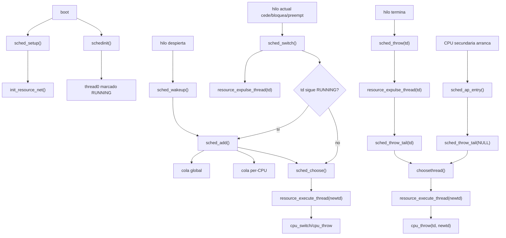
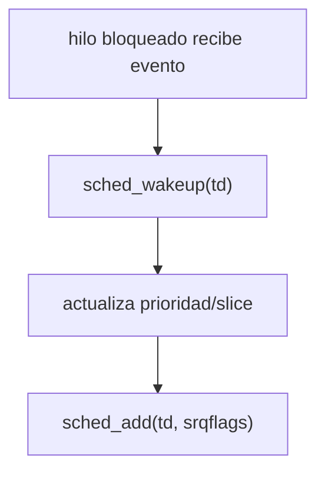
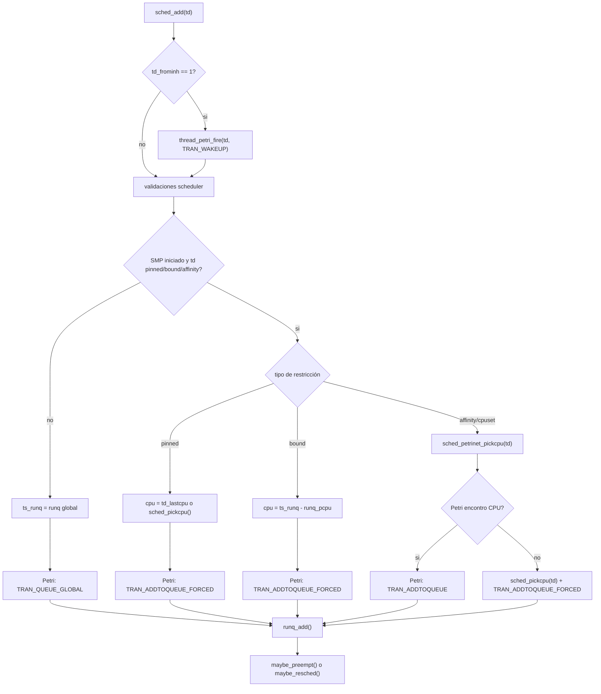
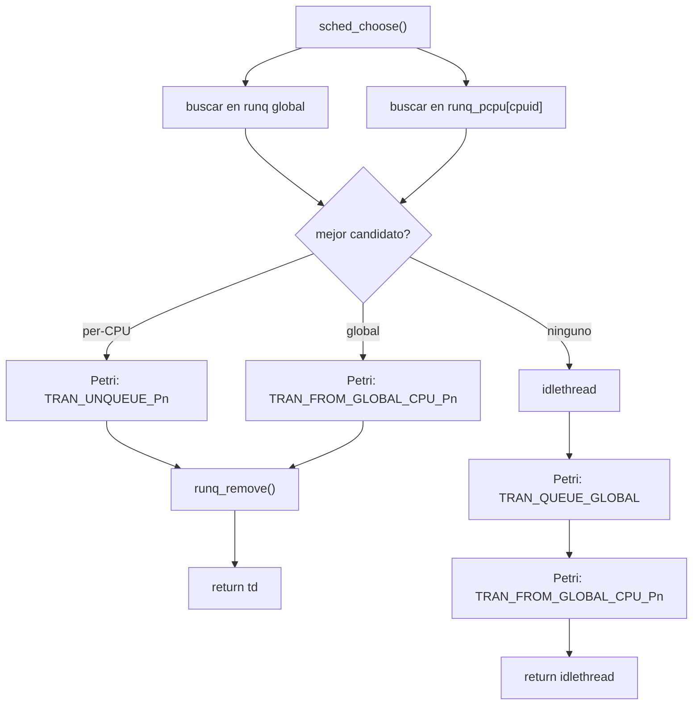
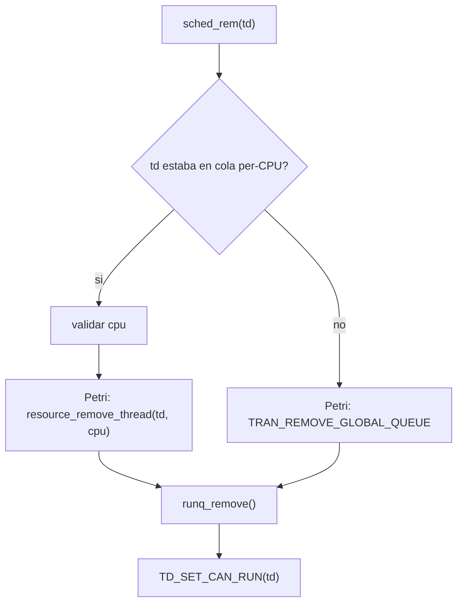
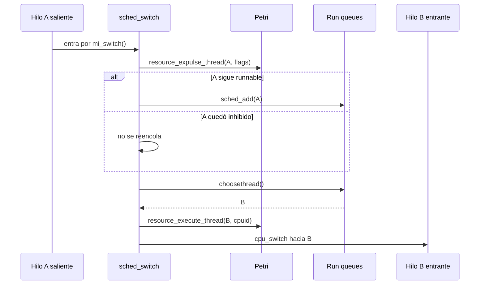
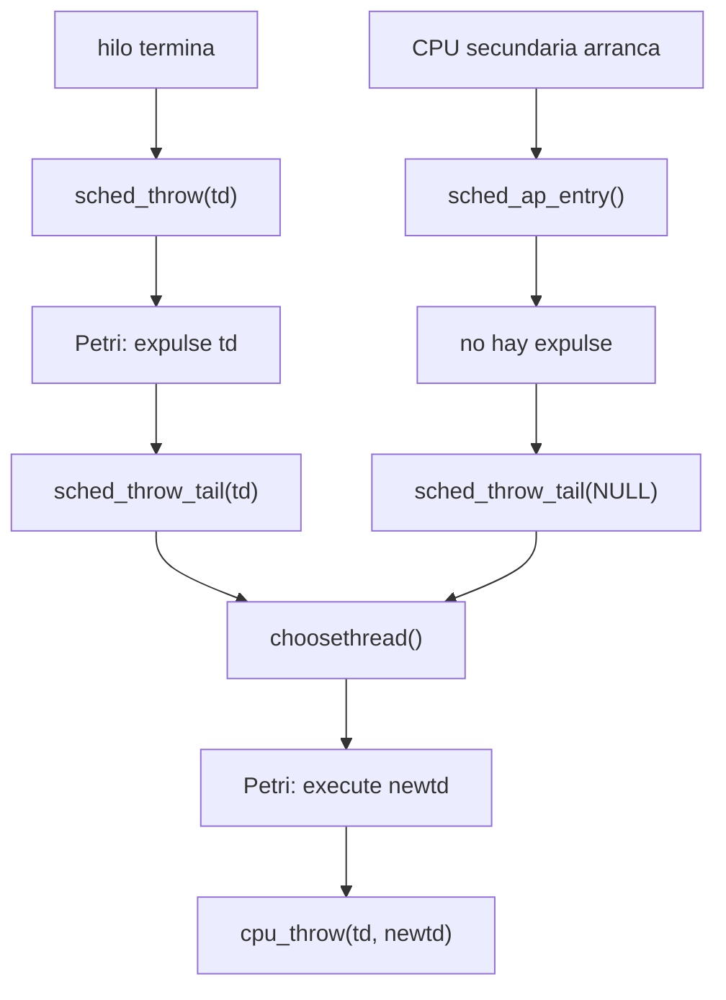

# Funcionamiento de sched_4bsd en los flujos tocados por la tesis

Este documento explica los métodos principales de `sys/kern/sched_4bsd.c` que quedan involucrados por la tesis y por el port a FreeBSD `main`. La explicación usa la modalidad actual de `main`, donde `sched_throw()` y `sched_ap_entry()` son caminos separados.

El objetivo no es documentar todo el planificador 4BSD. El objetivo es entender dónde se insertan los eventos Petri y cómo se relacionan los métodos que agregan, remueven, eligen, ejecutan o expulsan hilos.

## Modelo mental mínimo

El scheduler no es un hilo separado que corre por su cuenta. El código del scheduler lo ejecuta la CPU actual, usando el contexto del hilo actual, hasta que ocurre un cambio de contexto real.

En un cambio normal:

```text
CPU ejecuta hilo A
hilo A entra al scheduler
el scheduler actualiza estado de A
el scheduler elige hilo B
la CPU cambia de contexto
CPU ejecuta hilo B
```

Por eso, mientras `sched_switch()` o `sched_throw()` están corriendo, todavía se está ejecutando código desde el contexto del hilo saliente. El hilo entrante empieza realmente después de `cpu_switch()` o `cpu_throw()`.

## Estados importantes para Petri

La tesis modela dos niveles:

- red del hilo: estados como `CAN_RUN`, `RUNQ`, `RUNNING`, `INHIBITED`;
- red de recursos: colas, CPUs disponibles, CPUs ejecutando, cola global y deuda de balanceo.

Mapeo conceptual:

```text
sched_add       -> CAN_RUN/RUNNING pasa a RUNQ
sched_choose    -> RUNQ pasa hacia ejecución
sched_switch    -> RUNNING deja CPU y puede volver a cola o quedar inhibido
sched_rem       -> RUNQ sale de una cola sin ejecutar
sched_throw     -> RUNNING deja CPU y no vuelve
sched_ap_entry  -> CPU nueva entra sin hilo saliente real
```

## Mapa de métodos

| Método | Rol en 4BSD | Rol para Petri | Relación principal |
| --- | --- | --- | --- |
| `sched_setup()` | Inicializa run queues | Inicializa la red global de recursos | Boot |
| `schedinit()` | Inicializa `thread0` y `sched_lock` | Marca `thread0` como inicialmente ejecutando | Boot |
| `sched_fork_thread()` | Inicializa datos scheduler de un hilo hijo | Hereda afinidad y prepara estado scheduler; la red del hilo se inicializa fuera, en `thread_alloc()` | Creación de hilos |
| `sched_wakeup()` | Reactiva un hilo dormido | Termina llamando a `sched_add()` | Entrada a cola |
| `sched_add()` | Encola un hilo runnable | Dispara `TRAN_QUEUE_GLOBAL`, `TRAN_ADDTOQUEUE` o `TRAN_ADDTOQUEUE_FORCED` | Entrada a cola |
| `sched_petrinet_pickcpu()` | Wrapper local para elegir CPU con Petri | Llama a `resource_choose_cpu()` | Afinidad/cpuset |
| `sched_pickcpu()` | Selección 4BSD tradicional de CPU válida | Fallback cuando Petri no puede elegir o cuando FreeBSD impone una CPU | Afinidad/cpuset |
| `sched_choose()` | Elige el próximo hilo a ejecutar | Dispara `TRAN_UNQUEUE`, `TRAN_FROM_GLOBAL_CPU` o el camino `idlethread` | Salida de cola hacia CPU |
| `sched_rem()` | Remueve un hilo de una cola | Dispara remoción Petri de cola per-CPU o global | Remoción sin ejecutar |
| `sched_switch()` | Cambio normal de contexto | Expulsa hilo saliente y ejecuta hilo entrante | Cambio normal |
| `sched_throw()` | Descarta un hilo saliente real | Expulsa el hilo saliente y pasa a `sched_throw_tail()` | Salida definitiva |
| `sched_ap_entry()` | Entrada inicial de una CPU | No expulsa nada; pasa a `sched_throw_tail(NULL)` | Arranque de CPU |
| `sched_throw_tail()` | Parte común de `throw` y AP entry | Elige y registra ejecución del hilo entrante | Ejecución sin retorno |
| `sched_bind()` | Ata el hilo actual a una CPU | Produce casos `TDF_BOUND` que `sched_add()` debe respetar | Restricción dura |
| `sched_unbind()` | Quita `TDF_BOUND` | Permite volver a planificación normal | Restricción dura |
| `sched_is_bound()` | Consulta si un hilo está bound | Ayuda a otros subsistemas a respetar la condición | Restricción dura |
| `sched_affinity()` | Reacciona a cambios de cpuset/afinidad | Puede forzar `sched_rem()` + `sched_add()` si el hilo en cola quedó en CPU inválida | Restricción dura |

## Vista global de flujos



## Inicialización

### sched_setup()

`sched_setup()` corre durante el boot, cuando se inicializan las colas del scheduler.

Responsabilidades relevantes:

- llama a `setup_runqs()`;
- en el port Petri, llama a `init_resource_net()`;
- suma carga inicial para `thread0`.

Para Petri, este método es el punto donde se inicializa la red global de recursos. Esa red representa CPUs, colas per-CPU, cola global y estado SMP.

Flujo:

```text
sched_setup()
  setup_runqs()
  init_resource_net()
  sched_load_add()
```

### schedinit()

`schedinit()` inicializa partes scheduler de `thread0`, el hilo inicial del sistema.

Responsabilidades relevantes:

- asigna `thread0.td_lock = &sched_lock`;
- inicializa `sched_lock`;
- en el port Petri, deja el marcado inicial de `thread0` como `RUNNING`.

Esto es importante porque `thread0` no pasa por el camino normal de `thread_alloc()` como otros hilos. Por eso necesita un marcado inicial especial.

Flujo Petri:

```text
thread0.mark = { INACTIVE=0, CAN_RUN=0, RUNQ=0, RUNNING=1, INHIBITED=0 }
```

### sched_fork_thread()

`sched_fork_thread()` prepara los datos scheduler de un hilo hijo.

Responsabilidades relevantes:

- inicializa `td_oncpu` y `td_lastcpu` como `NOCPU`;
- asigna lock scheduler;
- hereda `td_cpuset`;
- hereda flags de afinidad (`TSF_AFFINITY`);
- inicializa slice y datos de prioridad.

La red del hilo no se inicializa acá en el port actual. Se inicializa en `thread_alloc()` mediante `init_petri_thread(td)`, protegido por `SCHED_4BSD`. `sched_fork_thread()` igual es relevante porque prepara datos que `sched_add()` usará después, especialmente afinidad y `td_cpuset`.

## Entrada a cola: sched_wakeup y sched_add

### sched_wakeup()

`sched_wakeup()` se ejecuta cuando un hilo que estaba dormido o bloqueado vuelve a estar listo para correr.

Responsabilidades relevantes:

- recalcula prioridad si durmió suficiente tiempo;
- reinicia `ts_slice`;
- restaura prioridad base de interrupt threads cuando corresponde;
- llama a `sched_add(td, srqflags)`.

`sched_wakeup()` no decide en que cola queda el hilo. Esa decisión se delega en `sched_add()`.



### sched_add()

`sched_add()` es uno de los puntos más importantes para la tesis. Su trabajo es poner un hilo ejecutable en alguna cola.

En SMP hay dos familias de cola:

- cola global `runq`;
- colas per-CPU `runq_pcpu[cpu]`.

La lógica relevante para Petri es:

```text
si el hilo no tiene restricción fuerte:
  usar cola global
  Petri: TRAN_QUEUE_GLOBAL

si el hilo está pinned:
  usar su CPU obligatoria
  Petri: TRAN_ADDTOQUEUE_FORCED

si el hilo está bound:
  usar la runqueue per-CPU ya asociada por FreeBSD
  Petri: TRAN_ADDTOQUEUE_FORCED

si el hilo tiene afinidad/cpuset:
  intentar elegir CPU válida con Petri
  si Petri puede: TRAN_ADDTOQUEUE
  si Petri no puede: fallback FreeBSD + TRAN_ADDTOQUEUE_FORCED
```

Diagrama:



### sched_petrinet_pickcpu()

`sched_petrinet_pickcpu()` es un wrapper chico que llama a `resource_choose_cpu(td)`.

Su rol es separar la decisión Petri de la lógica de `sched_add()`. Esta decisión solo se usa cuando FreeBSD tiene una restricción de afinidad/cpuset, pero todavía hay libertad para elegir una CPU dentro del conjunto permitido.

Si Petri no encuentra una transición `ADDTOQUEUE` sensibilizada en una CPU permitida, devuelve `NOCPU`. En ese caso `sched_add()` usa `sched_pickcpu(td)` como fallback y registra `TRAN_ADDTOQUEUE_FORCED`.

### sched_pickcpu()

`sched_pickcpu()` es la elección tradicional de 4BSD. Busca una CPU válida según `THREAD_CAN_SCHED()` y carga de colas.

En el port Petri sigue siendo necesario porqué hay casos donde no se puede delegar todo a Petri:

- `pinned` sin `td_lastcpu` válido;
- fallback de afinidad cuando Petri no encuentra transición sensibilizada;
- cualquier caso donde FreeBSD necesita una CPU válida aunque la política Petri no pueda decidir.

### maybe_preempt() y maybe_resched()

Estos métodos no son el centro de Petri, pero cierran el flujo de `sched_add()`.

Después de encolar un hilo, 4BSD decide si conviene interrumpir al hilo actual:

- `maybe_preempt(td)` intenta marcar preemption si el nuevo hilo tiene prioridad suficiente;
- si no hay preemption inmediata, `maybe_resched(td)` puede marcar que se reprograme después.

Petri no modela la decisión de prioridad como tal. Petri registra el encolado. El cambio de ejecución real llegará después por `sched_switch()`.

## Salida de cola hacia ejecución: sched_choose

`sched_choose()` elige el próximo hilo a ejecutar.

En SMP compara:

- mejor hilo en cola global;
- mejor hilo en cola per-CPU de la CPU actual.

Si elige desde cola per-CPU:

```text
Petri: TRAN_UNQUEUE_Pn
```

Si elige desde cola global:

```text
Petri: TRAN_FROM_GLOBAL_CPU_Pn
```

Si no hay ningún hilo:

```text
se devuelve idlethread
Petri simula pasaje por cola global
```

Diagrama:



`sched_choose()` no hace por sí solo el cambio de contexto. Solo devuelve el hilo elegido. Quien llame a `sched_choose()` debe luego registrar ejecución y saltar al hilo.

## Remocion de cola: sched_rem

`sched_rem()` saca un hilo de la cola sin ejecutarlo.

Casos típicos:

- un hilo en cola deja de ser elegible;
- cambia su afinidad y estaba en una cola que ya no corresponde;
- otro flujo del kernel necesita removerlo de runqueue.

Para Petri:

```text
si estaba en runq_pcpu[cpu]:
  resource_remove_thread(td, cpu)

si estaba en runq global:
  TRAN_REMOVE_GLOBAL_QUEUE
```

Después de actualizar Petri, FreeBSD hace:

```text
runq_remove(ts->ts_runq, td)
TD_SET_CAN_RUN(td)
```

Diagrama:



## Cambio normal de contexto: sched_switch

`sched_switch(td, flags)` es el camino normal de cambio de contexto.

El hilo `td` es el hilo saliente. El código todavía se está ejecutando en su contexto.

Responsabilidades relevantes:

1. guardar `td_lastcpu`;
2. limpiar estado de CPU actual (`td_oncpu = NOCPU`);
3. tomar `sched_lock` si hace falta;
4. registrar en Petri que el hilo saliente deja la CPU;
5. si el hilo saliente sigue `RUNNING`, volver a encolarlo con `sched_add()`;
6. elegir el próximo hilo con `choosethread()`;
7. registrar en Petri que el hilo entrante ejecuta;
8. hacer el cambio de contexto real.

Flujo simplificado:



Relación con otros métodos:

- llama a `sched_add()` si el hilo saliente debe volver a cola;
- llama indirectamente a `sched_choose()` via `choosethread()`;
- comparte con `sched_throw_tail()` la idea de "elegir nuevo hilo y registrar ejecución", pero no usa `sched_throw_tail()` porque `sched_switch()` tiene mucho manejo especifico de un cambio normal.

## Salida definitiva: sched_throw, sched_ap_entry y sched_throw_tail

Estos métodos son la diferencia más importante con `main`.

### sched_throw(td)

`sched_throw(td)` se usa cuando hay un hilo saliente real que no vuelve.

Ejemplo:

```text
un hilo termina
```

En `main`, `td` no puede ser `NULL`.

Flujo:

```text
sched_throw(td)
  validar td != NULL
  td_lastcpu = td_oncpu
  td_oncpu = NOCPU
  resource_expulse_thread(td, SW_VOL)
  sched_throw_tail(td)
```

### sched_ap_entry()

`sched_ap_entry()` se usa cuando una CPU secundaria entra por primera vez.

En este caso no hay hilo saliente real. Por eso no se puede llamar a `resource_expulse_thread()`.

Flujo:

```text
sched_ap_entry()
  preparar locks/spinlock nesting
  setear switchtime/switchticks
  sched_throw_tail(NULL)
```

### sched_throw_tail(td)

`sched_throw_tail(td)` es la parte común:

```text
sched_throw_tail(td)
  newtd = choosethread()
  resource_execute_thread(newtd, cpuid)
  cpu_throw(td, newtd)
```

Si viene desde `sched_throw(td)`, el parámetro `td` es el hilo saliente real.

Si viene desde `sched_ap_entry()`, el parámetro es `NULL`, porque la CPU está arrancando y no hay hilo saliente que expulsar.

Diagrama:



## Restricciones duras: bind, unbind y affinity

### sched_bind()

`sched_bind(td, cpu)` ata el hilo actual a una CPU concreta.

Efectos relevantes:

- marca `TDF_BOUND`;
- en SMP, deja `ts_runq` apuntando a `runq_pcpu[cpu]`;
- si el hilo no está corriendo en esa CPU, fuerza un `mi_switch()`.

Esto explica por qué `sched_add()` no puede dejar que Petri elija cualquier CPU para un hilo `bound`. FreeBSD ya decidio una CPU concreta.

### sched_unbind()

`sched_unbind(td)` limpia `TDF_BOUND`.

Desde ese momento el hilo deja de tener esa restricción dura y puede volver a seguir reglas normales de planificación.

### sched_is_bound()

`sched_is_bound(td)` consulta `TDF_BOUND`.

No modifica estado, pero permite que otros subsistemas sepan si el hilo está atado a una CPU.

### sched_affinity()

`sched_affinity(td)` reacciona cuando cambia la afinidad/cpuset de un hilo.

Responsabilidades relevantes:

- recalcula `TSF_AFFINITY`;
- si el hilo puede correr en todas las CPUs, no hace nada;
- si el hilo está `pinned` o `bound`, no lo mueve;
- si el hilo está en runqueue pero en una CPU ya no permitida, hace `sched_rem(td)` y luego `sched_add(td)`;
- si el hilo está ejecutando en una CPU no permitida, marca AST para forzar cambio de contexto.

Relación con Petri:

```text
sched_affinity()
  puede forzar sched_rem()
  puede forzar sched_add()
```

Por eso `sched_add()` necesita distinguir afinidad de un caso normal. Cuando la afinidad restringe las CPUs permitidas, Petri puede elegir solo dentro de ese conjunto. Si no puede elegir una transición normal sensibilizada, FreeBSD hace fallback a una CPU permitida y Petri registra `ADDTOQUEUE_FORCED`.

## Flujos que se parecen pero no son lo mismo

### sched_switch vs sched_throw

Ambos sacan un hilo de CPU y eligen otro hilo.

La diferencia:

```text
sched_switch:
  el hilo saliente puede volver a correr después.
  si sigue RUNNING, se reencola con sched_add().

sched_throw:
  el hilo saliente no vuelve.
  no se reencola.
```

### sched_throw vs sched_ap_entry

Ambos terminan en `sched_throw_tail()`.

La diferencia:

```text
sched_throw:
  hay hilo saliente real.
  Petri debe registrar expulsión.

sched_ap_entry:
  no hay hilo saliente real.
  Petri no debe expulsar nada.
```

### sched_add vs sched_rem

Son operaciones opuestas sobre colas, pero no siempre aparecen juntas.

```text
sched_add:
  hilo entra a una cola.

sched_rem:
  hilo sale de una cola sin ser elegido para ejecutar.
```

Cuando un hilo sale de cola porque va a ejecutar, el camino normal es `sched_choose()`, no `sched_rem()`.

### sched_choose vs resource_execute_thread

`sched_choose()` elige y remueve un hilo de una cola.

`resource_execute_thread()` registra en Petri que ese hilo pasa a ejecutar en una CPU.

No son lo mismo:

```text
sched_choose:
  RUNQ -> elegido/removido de cola

resource_execute_thread:
  elegido -> RUNNING
```

Por eso el port llama a `resource_execute_thread()` después de `choosethread()`, tanto en `sched_switch()` como en `sched_throw_tail()`.

## Resumen por camino

### Hilo despierta y queda listo

```text
sched_wakeup()
  sched_add()
    Petri: QUEUE_GLOBAL o ADDTOQUEUE o ADDTOQUEUE_FORCED
```

### Hilo actual cede CPU o se bloquea

```text
sched_switch()
  Petri: expulse hilo saliente
  si corresponde: sched_add(hilo saliente)
  choosethread()
    sched_choose()
  Petri: execute hilo entrante
  cpu_switch()
```

### Hilo termina

```text
sched_throw(td)
  Petri: expulse td
  sched_throw_tail(td)
    choosethread()
    Petri: execute newtd
    cpu_throw(td, newtd)
```

### CPU secundaria arranca

```text
sched_ap_entry()
  sched_throw_tail(NULL)
    choosethread()
    Petri: execute newtd
    cpu_throw(NULL, newtd)
```

### Afinidad cambia mientras un hilo está en cola

```text
sched_affinity(td)
  si la cola actual ya no es válida:
    sched_rem(td)
    sched_add(td)
```

## Regla final para leer el código

La pregunta que conviene hacer en cada método es:

```text
Qué hecho real acaba de ocurrir en FreeBSD?
```

Después, Petri debe registrar ese hecho:

```text
entra a cola global       -> TRAN_QUEUE_GLOBAL
entra a cola per-CPU libre -> TRAN_ADDTOQUEUE
entra a cola per-CPU obligada -> TRAN_ADDTOQUEUE_FORCED
sale de cola per-CPU      -> TRAN_UNQUEUE o REMOVE_QUEUE
sale de cola global       -> TRAN_FROM_GLOBAL_CPU o REMOVE_GLOBAL_QUEUE
deja de ejecutar          -> RETURN_VOL o RETURN_INVOL
empieza a ejecutar        -> EXEC o EXEC_EMPTY
```

La red Petri no debe inventar un estado distinto al del scheduler real. Esa es la razón por la que `ADDTOQUEUE_FORCED` y la separación moderna de `sched_throw()` son importantes para el port a `main`.

## Ejemplo completo de recorrido de un hilo

Este ejemplo es didáctico. En una ejecución real, no todos los hilos pasan por todos estos métodos. Algunos caminos son alternativos entre sí. Por ejemplo, un hilo no "necesita" pasar por `sched_rem()` antes de ejecutar; si sale de la cola para ejecutar, lo normal es que pase por `sched_choose()`. Aun así, el ejemplo sirve para ver cómo se conectan las piezas.

Se usa un hilo ficticio:

```text
H = hilo de usuario
CPU0 = CPU donde empieza ejecutando
CPU1 = otra CPU permitida
```

### Vista completa

```mermaid
flowchart TD
    A["1. Se crea H"] --> B["thread_alloc()"]
    B --> C["init_petri_thread(H)"]
    C --> D["sched_fork_thread(parent, H)"]

    D --> E["2. H queda listo"]
    E --> F["sched_wakeup(H)"]
    F --> G["sched_add(H)"]
    G --> H1{"restricción de CPU?"}
    H1 -- "sin restricción" --> I["Petri: TRAN_QUEUE_GLOBAL"]
    H1 -- "afinidad/pinned/bound" --> J["Petri: TRAN_ADDTOQUEUE o TRAN_ADDTOQUEUE_FORCED"]

    I --> K["3. CPU0 necesita elegir hilo"]
    J --> K
    K --> L["sched_choose()"]
    L --> M["Petri: TRAN_FROM_GLOBAL_CPU o TRAN_UNQUEUE"]
    M --> N["resource_execute_thread(H, CPU0)"]
    N --> O["H queda RUNNING"]

    O --> P["4. H cede CPU o se bloquea"]
    P --> Q["sched_switch(H, flags)"]
    Q --> R["Petri: RETURN_VOL o RETURN_INVOL"]
    R --> S{"H sigue runnable?"}
    S -- "si" --> T["sched_add(H)"]
    S -- "no" --> U["H queda inhibido"]

    T --> V["5. Cambia afinidad de H en cola"]
    V --> W["sched_affinity(H)"]
    W --> X{"cola actual sigue válida?"}
    X -- "si" --> Y["no se mueve"]
    X -- "no" --> Z["sched_rem(H)"]
    Z --> AA["Petri: REMOVE_QUEUE o REMOVE_GLOBAL_QUEUE"]
    AA --> AB["sched_add(H) con nueva afinidad"]

    AB --> AC["6. H ejecuta otra vez"]
    AC --> AD["sched_choose()"]
    AD --> AE["resource_execute_thread(H, CPU permitida)"]
    AE --> AF["H queda RUNNING"]

    AF --> AG["7. H se ata a CPU1"]
    AG --> AH["sched_bind(H, CPU1)"]
    AH --> AI["TDF_BOUND + ts_runq = runq_pcpu[CPU1]"]
    AI --> AJ{"H ya está en CPU1?"}
    AJ -- "no" --> AK["mi_switch() -> sched_switch(H)"]
    AJ -- "si" --> AL["continúa ejecutando"]

    AK --> AM["8. H vuelve a cola bound"]
    AM --> AN["sched_add(H)"]
    AN --> AO["Petri: TRAN_ADDTOQUEUE_FORCED"]

    AO --> AP["9. H termina"]
    AP --> AQ["sched_throw(H)"]
    AQ --> AR["Petri: expulse H"]
    AR --> AS["sched_throw_tail(H)"]
    AS --> AT["choosethread()"]
    AT --> AU["Petri: execute siguiente hilo"]
    AU --> AV["cpu_throw(H, newtd)"]
```



### Paso 1: creación del hilo

Cuando el kernel crea el hilo `H`, primero se reserva e inicializa la estructura `struct thread`.

En el port Petri:

```text
thread_alloc()
  init_petri_thread(H)
```

Eso deja la red local del hilo en su marcado inicial. Luego, cuando el scheduler prepara datos específicos de 4BSD:

```text
sched_fork_thread(parent, H)
```

se completan datos como:

- `td_oncpu = NOCPU`;
- `td_lastcpu = NOCPU`;
- `td_cpuset`;
- prioridad inicial;
- flags de afinidad heredados.

En este momento `H` todavía no está ejecutando.

### Paso 2: el hilo queda listo y entra a una cola

Cuando `H` queda listo para correr, puede llegar por:

```text
sched_wakeup(H)
```

Ese método actualiza prioridad y slice, pero delega la decisión importante:

```text
sched_add(H)
```

Si `H` no tiene restricciones fuertes, entra a la cola global:

```text
sched_add(H)
  ts_runq = &runq
  Petri: TRAN_QUEUE_GLOBAL
  runq_add()
```

Si `H` tiene afinidad, `pinned` o `bound`, entra a una cola per-CPU:

```text
sched_add(H)
  elegir CPU válida
  Petri: TRAN_ADDTOQUEUE o TRAN_ADDTOQUEUE_FORCED
  runq_add()
```

La diferencia entre `ADDTOQUEUE` y `ADDTOQUEUE_FORCED` es:

```text
ADDTOQUEUE:
  Petri pudo elegir una CPU válida y sensibilizada.

ADDTOQUEUE_FORCED:
  FreeBSD necesitaba esa CPU o Petri no encontró una transición normal válida.
```

### Paso 3: una CPU elige a H para ejecutar

Cuando una CPU necesita un hilo, llama indirectamente a:

```text
sched_choose()
```

Si `H` estaba en cola global:

```text
sched_choose()
  Petri: TRAN_FROM_GLOBAL_CPU_Pn
  runq_remove()
  return H
```

Si `H` estaba en cola per-CPU:

```text
sched_choose()
  Petri: TRAN_UNQUEUE_Pn
  runq_remove()
  return H
```

Después de elegirlo, el método que llamó a `sched_choose()` registra la ejecución:

```text
resource_execute_thread(H, CPU0)
```

Ahora Petri registra que `H` pasó a `RUNNING`.

### Paso 4: H deja la CPU por un cambio normal

Supóngase que `H` se bloquea, cede CPU o es reemplazado. El camino normal es:

```text
sched_switch(H, flags)
```

Primero se registra que `H` deja la CPU:

```text
resource_expulse_thread(H, flags)
```

Eso dispara:

```text
SW_VOL   -> TRAN_RETURN_VOL
SW_INVOL -> TRAN_RETURN_INVOL
```

Después hay dos posibilidades.

Si `H` sigue siendo ejecutable:

```text
sched_switch(H)
  sched_add(H)
```

Si `H` quedó esperando un evento:

```text
sched_switch(H)
  no se reencola H
```

En ambos casos, `sched_switch()` elige otro hilo:

```text
newtd = choosethread()
resource_execute_thread(newtd, CPU0)
cpu_switch hacia newtd
```

### Paso 5: H está en cola y cambia su afinidad

Supóngase ahora que `H` está esperando en una cola y cambia su cpuset o afinidad.

El método relevante es:

```text
sched_affinity(H)
```

Si `H` estaba en una cola per-CPU que sigue permitida, no se mueve.

Si `H` estaba en una cola que ya no es válida:

```text
sched_affinity(H)
  sched_rem(H)
  sched_add(H)
```

Este es un caso importante para entender la diferencia entre `sched_rem()` y `sched_choose()`.

```text
sched_choose():
  saca el hilo de la cola porque lo va a ejecutar.

sched_rem():
  saca el hilo de la cola porque esa cola ya no corresponde.
```

Petri registra:

```text
sched_rem(H)
  REMOVE_QUEUE o REMOVE_GLOBAL_QUEUE

sched_add(H)
  QUEUE_GLOBAL, ADDTOQUEUE o ADDTOQUEUE_FORCED
```

### Paso 6: H ejecuta otra vez

Luego, una CPU vuelve a elegir a `H`:

```text
sched_choose()
resource_execute_thread(H, cpu)
```

Este paso es similar al paso 3. La diferencia es que ahora la CPU elegida puede estar condicionada por la afinidad nueva.

### Paso 7: H se ata a una CPU concreta

Supóngase que `H` llama o llega a un flujo que lo ata a `CPU1`:

```text
sched_bind(H, CPU1)
```

Ese método:

```text
td_flags |= TDF_BOUND
ts_runq = &runq_pcpu[CPU1]
```

Si `H` no está corriendo en `CPU1`, FreeBSD fuerza un cambio:

```text
mi_switch(SW_VOL | SWT_BIND)
```

Ese `mi_switch()` termina entrando al flujo normal:

```text
sched_switch(H, flags)
```

Cuando `H` tenga que reencolarse como bound, `sched_add()` no debe pedirle a Petri que elija cualquier CPU. Debe respetar la CPU impuesta por FreeBSD:

```text
sched_add(H)
  detecta TDF_BOUND
  cpu = ts_runq - runq_pcpu
  Petri: TRAN_ADDTOQUEUE_FORCED
```

### Paso 8: H deja de estar bound

En algún momento puede ejecutarse:

```text
sched_unbind(H)
```

Eso limpia:

```text
TDF_BOUND
```

Desde ese momento, `H` vuelve a depender de reglas normales de planificación, salvo que tenga otras restricciones como afinidad o pinning.

### Paso 9: H termina

Cuando `H` termina definitivamente, no se usa el flujo normal de `sched_switch()` como si pudiera volver.

Se usa:

```text
sched_throw(H)
```

Flujo:

```text
sched_throw(H)
  H existe y es el hilo saliente real
  Petri: resource_expulse_thread(H, SW_VOL)
  sched_throw_tail(H)
    newtd = choosethread()
    Petri: resource_execute_thread(newtd, cpu)
    cpu_throw(H, newtd)
```

La diferencia con `sched_switch()` es que `H` no se reencola. Su contexto se descarta.

### Camino separado: arranque de una CPU

El arranque de una CPU no es parte de la vida de `H`, pero conviene ponerlo al lado porque comparte `sched_throw_tail()`.

Cuando una CPU secundaria arranca:

```text
sched_ap_entry()
```

No hay hilo saliente real. Por lo tanto:

```text
no se llama a resource_expulse_thread()
```

El flujo es:

```text
sched_ap_entry()
  sched_throw_tail(NULL)
    newtd = choosethread()
    Petri: resource_execute_thread(newtd, cpu)
    cpu_throw(NULL, newtd)
```

Esta es la razón principal para no tratar `sched_throw()` y `sched_ap_entry()` como si fueran lo mismo en FreeBSD `main`.

## Lectura del ejemplo en una línea

```text
crear H -> inicializar Petri local -> wakeup -> add -> choose -> execute -> switch/expulse -> tal vez add otra vez -> affinity puede rem/remove+add -> bind puede forzar switch y add forced -> throw descarta H -> AP entry es un camino separado sin H saliente
```
