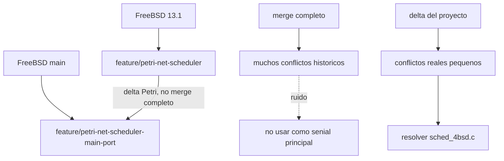

# Contexto del port a main

## Problema inicial

La rama base del planificador Petri estaba basada en FreeBSD 13.1. La pregunta del experimento fue:

```text
Que tan lejos esta el trabajo Petri de FreeBSD main?
```

Una primera estrategia posible era hacer un merge directo:

```text
origin/main + feature/petri-net-scheduler
```

Ese merge completo produjo una cantidad enorme de conflictos. Ese resultado no era una buena medida tecnica del problema real, porque mezclaba dos cosas:

1. diferencias propias de FreeBSD entre 13.1 y `main`;
2. cambios reales del proyecto Petri.

En otras palabras, el merge completo arrastraba historia vieja de FreeBSD y convertia el analisis en ruido.

## Estrategia usada

La estrategia mas util fue aplicar solamente el delta del proyecto:

```text
git diff origin/release13.1...feature/petri-net-scheduler
```

Ese delta representa:

```text
FreeBSD 13.1 limpio
        +
cambios de la rama base Petri
```

Aplicar ese patch sobre `origin/main` responde una pregunta mas precisa:

```text
Si se toma solo el trabajo Petri, que hay que adaptar para que entre en main?
```

Con ese enfoque, los conflictos se redujeron a:

```text
.gitignore
sys/kern/sched_4bsd.c
```

El conflicto de `.gitignore` fue trivial. El conflicto real estuvo en `sched_4bsd.c`.

## Mapa general



## Que se considera dentro del alcance

Este port incluye la base del planificador Petri:

- red del hilo;
- red global de recursos CPU;
- integracion con `sched_4bsd.c`;
- `ADDTOQUEUE_FORCED`;
- trazabilidad DTrace de decisiones `sched_add`;
- `PI_KERNELCONF`.

Este port no incluye:

- modulo de encendido/apagado de CPUs;
- modulo de monopolizacion;
- PRs stacked sobre esos modulos.

## Por que importa separar base y modulos

La base Petri debe quedar como plataforma comun. Si se mezclan los modulos en el mismo PR, se vuelve dificil responder:

```text
El problema esta en el scheduler Petri base?
El problema esta en on/off?
El problema esta en monopolizacion?
El problema es un conflicto con main?
```

Separar los PRs permite validar primero que el scheduler base puede vivir sobre `main`. Despues, los modulos pueden rebasearse sobre esa base sin duplicar arreglos.

## Resultado del experimento

El resultado preliminar es positivo:

```text
El port base a main es viable.
```

La razon es que no aparecio un choque conceptual grande entre Petri y `main`. El cambio relevante de FreeBSD fue principalmente estructural: la separacion de `sched_throw()` y `sched_ap_entry()`.

El resto de la logica Petri se pudo mantener casi igual a la rama 13.1, con ajustes de integracion para que el PR sea revisable.
