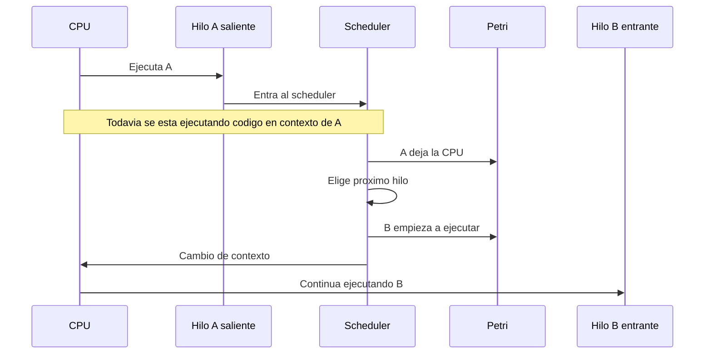
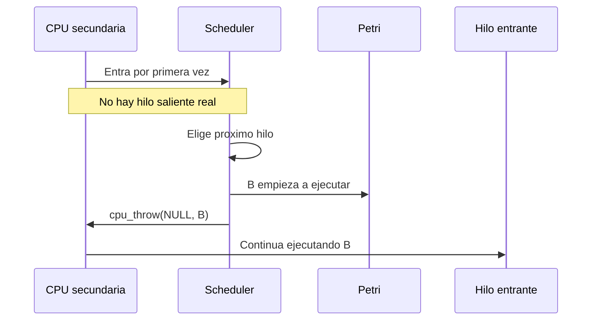
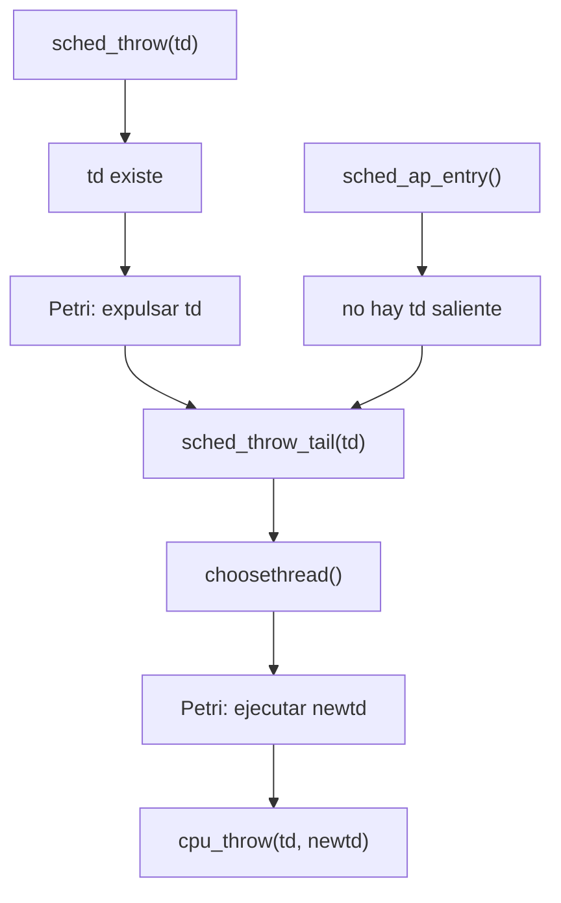

# sched_throw, sched_ap_entry y quien ejecuta el scheduler

## Idea clave

El codigo del scheduler no lo ejecuta magicamente "el hilo que entra".

Lo ejecuta la CPU que esta corriendo en ese momento, usando el contexto del hilo actual, hasta que ocurre el cambio de contexto real.

Eso significa:

```text
Antes del cambio de contexto:
  se sigue ejecutando el hilo saliente.

Despues del cambio de contexto:
  empieza a ejecutar el hilo entrante.
```

## Cambio normal de contexto

Ejemplo:

```text
CPU0 esta ejecutando hilo A.
Hilo A hace yield, se bloquea o debe ser reemplazado.
CPU0 entra al scheduler todavia en contexto de A.
El scheduler elige hilo B.
Se ejecuta la rutina de cambio de contexto.
CPU0 continua ejecutando B.
```

Diagrama:



## Diferencia entre sched_switch y sched_throw

`sched_switch()` representa un cambio normal. El hilo saliente puede volver mas tarde.

Ejemplos:

- un hilo hace sleep;
- un hilo cede CPU;
- un hilo es reemplazado por preemption;
- el hilo queda en una cola para ejecutar nuevamente.

`sched_throw()` es distinto. Se usa cuando el contexto actual se descarta. El hilo saliente existe, pero no vuelve por el camino normal.

Ejemplo tipico:

```text
un hilo termina
```

En ese caso:

```text
td = hilo que sale
scheduler elige newtd
cpu_throw(td, newtd)
```

La palabra "throw" puede pensarse como:

```text
tirar el contexto actual y saltar a otro
```

## El caso raro: arranque de CPUs

Cuando una CPU secundaria arranca, no hay un hilo real que este saliendo.

La CPU entra por primera vez al scheduler y necesita elegir algo para ejecutar. Pero no existe un `td` anterior que Petri pueda expulsar.

Conceptualmente:

```text
CPU nueva arranca
no hay hilo saliente real
se elige un hilo entrante
la CPU empieza a ejecutar ese hilo
```

Diagrama:



## Como era antes

En la version vieja, FreeBSD reutilizaba `sched_throw()` para ambos casos:

```text
sched_throw(td)    -> hilo real saliendo
sched_throw(NULL)  -> CPU arrancando, sin hilo saliente
```

Eso hacia que `sched_throw()` tuviera que preguntar:

```text
hay td real?
```

Para Petri, eso era delicado porque:

```text
si td existe:
  se debe registrar que el hilo deja la CPU

si td es NULL:
  no se debe expulsar ningun hilo
```

## Como es en main

FreeBSD `main` separo los casos. El cambio relevante esta en el commit:

```text
6a8ea6d17498 sched: split sched_ap_entry() out of sched_throw()
```

La intencion del cambio en FreeBSD fue limpiar la ruta comun:

```text
sched_throw(td)
  caso real: un hilo existente sale

sched_ap_entry()
  caso especial: una CPU arranca

sched_throw_tail(td)
  parte comun: elegir el proximo hilo y saltar a el
```

Diagrama:



## Que hubo que hacer en el port

La regla correcta para Petri es:

```text
Si hay hilo saliente real:
  resource_expulse_thread(td)

Si no hay hilo saliente:
  no expulsar nada

Siempre que se elige un hilo entrante:
  resource_execute_thread(newtd, cpu)
```

En `main`, eso se traduce asi:

```text
sched_throw(td):
  resource_expulse_thread(td, SW_VOL)
  sched_throw_tail(td)

sched_ap_entry():
  sched_throw_tail(NULL)

sched_throw_tail(td):
  newtd = choosethread()
  resource_execute_thread(newtd, PCPU_GET(cpuid))
  cpu_throw(td, newtd)
```

## Por que no habia que volver al diseno viejo

Una solucion tentadora habria sido reintroducir una logica tipo:

```text
sched_throw(NULL)
```

Pero eso iria contra la direccion actual de FreeBSD `main`.

La solucion usada respeta el diseno nuevo:

- `sched_throw()` no recibe `NULL`;
- `sched_ap_entry()` cubre el arranque de CPUs;
- Petri solo expulsa cuando existe un hilo saliente real;
- Petri siempre registra la ejecucion del hilo entrante en la parte comun.

## Resumen mental

```text
sched_switch:
  cambio normal; el hilo saliente puede volver.

sched_throw:
  el hilo saliente existe, pero no vuelve.

sched_ap_entry:
  arranca una CPU; no hay hilo saliente.

sched_throw_tail:
  parte comun; elige el proximo hilo y salta a el.
```

Para el modelo Petri:

```text
salida real de hilo  -> expulse
entrada de hilo      -> execute
arranque de CPU      -> execute, sin expulse
```
