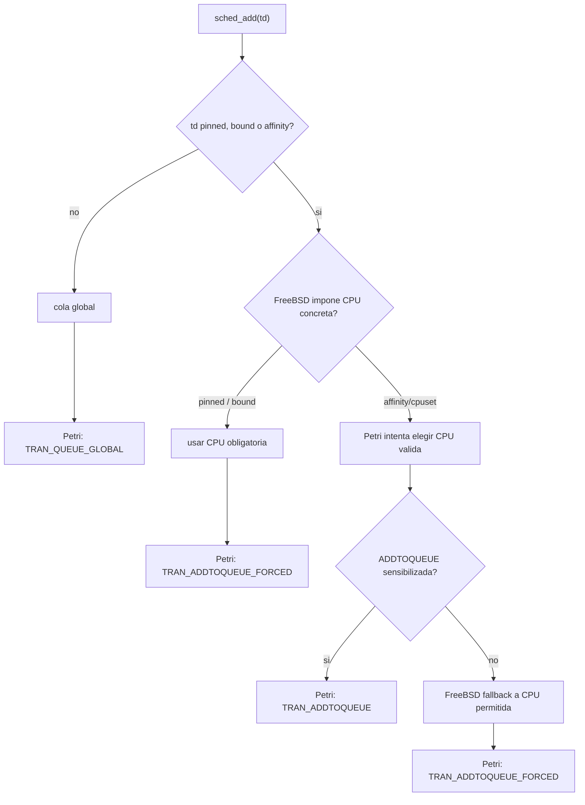
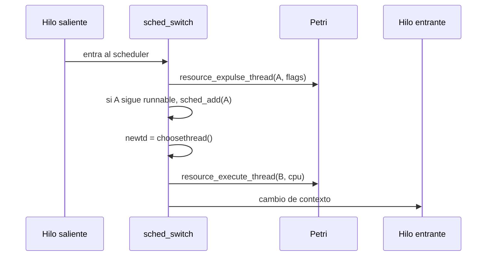

# Cambios reales entre Petri sobre 13.1 y Petri sobre main

## Resumen

Fuera del caso `sched_throw()`, el port a `main` no requirio un redisenio de la logica Petri.

La mayoria de los cambios son de integracion:

- insertar los hooks Petri en el `sched_4bsd.c` actual;
- no arrastrar un `PI_KERNELCONF` viejo;
- no compilar Petri en kernels que no usan 4BSD;
- limpiar detalles de C que podian dificultar revision o build.

## Tabla de cambios

| Area | Cambio respecto de 13.1 | Tipo | Motivo |
| --- | --- | --- | --- |
| `sched_throw()` | Se adapto a la separacion `sched_throw()` / `sched_ap_entry()` / `sched_throw_tail()` | Funcional por API nueva | FreeBSD `main` ya no usa `sched_throw(NULL)` |
| `sched_add()` | Misma logica general de Petri + `ADDTOQUEUE_FORCED` | Misma logica | Mantener sincronizada la red sin romper `pinned`, `bound` ni afinidad |
| `sched_switch()` | Mismos eventos Petri: expulsion del saliente y ejecucion del entrante | Misma logica | Reflejar `RUNNING -> ...` y `... -> RUNNING` en la red |
| `sched_choose()` | Mismo registro de cola per-CPU, cola global e `idlethread` | Misma logica | Mantener coherencia del marcado cuando se elige un hilo |
| `sched_rem()` | Mismo registro al remover de cola per-CPU o global | Misma logica | Evitar que Petri conserve hilos que FreeBSD ya removio |
| `PI_KERNELCONF` | Rehecho desde el `GENERIC` actual de `main` | Integracion | Evitar arrastrar diferencias viejas de 13.1 |
| `sys/conf/files` | Archivos Petri como `optional sched_4bsd` | Integracion | Evitar meter Petri en kernels ULE o no 4BSD |
| `kern_thread.c` | Inicializacion Petri bajo `#ifdef SCHED_4BSD` | Integracion | Evitar dependencia Petri fuera de 4BSD |
| estilo C | Limpieza de formato, helpers muertos y variables no usadas | Mantenimiento | Reducir riesgo de build/review |

## sched_add

La logica importante en `sched_add()` es la misma que ya se venia usando.

La regla conceptual es:

```text
Hilo normal:
  va a cola global.

Hilo pinned:
  debe ir a su CPU.

Hilo bound:
  debe ir a la CPU asociada por FreeBSD.

Hilo con afinidad/cpuset:
  debe ir a una CPU permitida.
```

Petri participa cuando hay libertad de politica. No debe anular restricciones que FreeBSD considera obligatorias.



### Por que existe ADDTOQUEUE_FORCED

`ADDTOQUEUE_FORCED` no es una forma de ignorar Petri. Es una forma de registrar en Petri un evento que FreeBSD debe realizar.

Sin esa transicion, podia pasar esto:

```text
FreeBSD:
  debe encolar un hilo en runq_pcpu[1]

Petri:
  ADDTOQUEUE_P1 esta inhibida por CANTQ_P1

Resultado:
  FreeBSD encola realmente el hilo
  Petri no registra el evento
  la red queda desincronizada
```

Con `ADDTOQUEUE_FORCED`:

```text
FreeBSD:
  encola el hilo donde debe

Petri:
  registra el encolado forced
  incrementa QUEUE
  incrementa CANTQ
```

Esto mantiene la penalizacion de balanceo, pero evita que la red bloquee una restriccion dura del kernel.

## sched_switch

La idea se mantiene:

```text
hilo saliente deja CPU -> resource_expulse_thread()
hilo entrante ejecuta  -> resource_execute_thread()
```

La diferencia con `main` no fue conceptual. El codigo alrededor de `sched_switch()` esta mas actualizado que en 13.1, por lo que los hooks se ubicaron donde el estado del hilo ya es coherente para actualizar Petri.

Flujo simplificado:



## sched_choose

El trabajo de `sched_choose()` es elegir que hilo ejecutar.

En Petri importa de donde salio ese hilo:

```text
cola per-CPU:
  TRAN_UNQUEUE_Pn

cola global:
  TRAN_FROM_GLOBAL_CPU_Pn

sin hilos disponibles:
  idlethread
```

El `idlethread` es especial porque no representa trabajo real de usuario. Aun asi, Petri necesita registrar un pasaje coherente para que el marcado del hilo y de los recursos no quede roto.

## sched_rem

`sched_rem()` remueve un hilo de una cola.

Si FreeBSD remueve el hilo y Petri no lo registra, la red cree que el hilo sigue en cola. Por eso se conserva:

```text
cola per-CPU:
  resource_remove_thread(td, cpu)

cola global:
  TRAN_REMOVE_GLOBAL_QUEUE
```

## PI_KERNELCONF

En vez de traer el archivo viejo de 13.1, se tomo el `GENERIC` actual de `main` y se aplicaron solo las diferencias necesarias:

```text
ident PI_KERNELCONF
SCHED_4BSD habilitado
SCHED_ULE deshabilitado
DIAGNOSTIC habilitado
KDB_UNATTENDED habilitado
```

Esto evita que el PR muestre cientos de cambios irrelevantes por diferencias entre un `GENERIC` viejo y uno actual.

## sys/conf/files y kern_thread.c

El primer delta traia los archivos Petri como `standard`. Eso significa:

```text
compilar Petri en cualquier kernel
```

Para un PR contra `main`, eso no era conveniente. La integracion quedo asi:

```text
kern/petri_global_net.c  optional sched_4bsd
kern/sched_petri.c       optional sched_4bsd
```

Y en `kern_thread.c`:

```c
#ifdef SCHED_4BSD
init_petri_thread(td);
#endif
```

Con esto, Petri queda atado al planificador 4BSD, que es donde realmente se integra.

## Que no se cambio

No se cambio la idea central del modelo:

```text
ADDTOQUEUE
UNQUEUE
EXEC
RETURN_VOL
RETURN_INVOL
FROM_GLOBAL_CPU
REMOVE_QUEUE
REMOVE_GLOBAL_QUEUE
ADDTOQUEUE_FORCED
```

Tampoco se agregaron los modulos:

```text
CPU on/off
CPU monopolize
```

Esos deberian llegar despues, en PRs separados.
