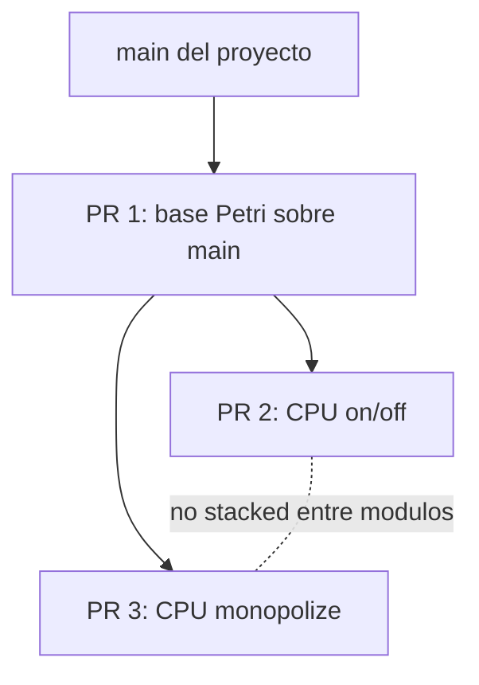

# Viabilidad del PR base contra main

## Conclusion

El port base del planificador Petri a `main` es viable para un PR contra el repositorio del proyecto.

No deberia presentarse todavia como un cambio listo para FreeBSD upstream. El objetivo razonable es:

```text
main del repositorio del proyecto
```

no:

```text
freebsd/freebsd-src main
```

## Por que parece viable

### 1. El conflicto real fue pequeno

El merge completo produjo muchos conflictos porque mezclaba historia vieja de FreeBSD. Pero aplicando solo el delta Petri, el conflicto sustantivo quedo en:

```text
sys/kern/sched_4bsd.c
```

Eso indica que el trabajo Petri base no esta conceptualmente lejos de `main`. Esta lejos solamente si se intenta arrastrar toda la historia de la rama 13.1.

### 2. El cambio principal de main se puede respetar

FreeBSD `main` separo:

```text
sched_throw()
sched_ap_entry()
sched_throw_tail()
```

El port respeta esa separacion. No intenta volver al diseno viejo de `sched_throw(NULL)`.

### 3. ADDTOQUEUE_FORCED sigue resolviendo el problema correcto

El problema detectado en 13.1 no desaparece por pasar a `main`:

```text
FreeBSD puede necesitar una CPU concreta.
Petri puede tener inhibida la transicion normal.
Si FreeBSD avanza y Petri no registra, la red queda desincronizada.
```

`ADDTOQUEUE_FORCED` sigue siendo la respuesta correcta para registrar eventos obligatorios de FreeBSD sin romper el marcado Petri.

### 4. El kernel normal queda menos afectado

La integracion quedo limitada a `SCHED_4BSD`:

```text
kern/petri_global_net.c  optional sched_4bsd
kern/sched_petri.c       optional sched_4bsd
```

Esto mejora el PR porque evita meter archivos Petri en kernels que no usan 4BSD.

## Riesgos que siguen abiertos

### CPU_NUMBER hardcodeado

El modelo usa:

```c
#define CPU_NUMBER 4
```

Esto es aceptable para la VM de prueba si la VM tiene 4 CPUs. No es una solucion general.

Riesgo:

```text
si el kernel corre con otra cantidad de CPUs, el modelo puede quedar mal
dimensionado.
```

Sugerencia:

```text
documentar la restriccion para el PR base
o convertir CPU_NUMBER en una configuracion derivada del kernel en un PR futuro.
```

### Cambios en struct thread

El port agrega campos a `struct thread`:

```c
int td_frominh;
int mark[PLACES_SIZE];
int sensitized_buffer[TRANSITIONS_SIZE];
```

Esto afecta el layout de una estructura central del kernel.

Aunque la logica Petri se limite a `SCHED_4BSD`, el cambio de estructura es global en la compilacion.

Sugerencia:

```text
aceptarlo para el prototipo del proyecto
pero marcarlo como punto a mejorar si se busca una integracion mas limpia.
```

### Falta build real en FreeBSD

La revision local se hizo desde macOS/Darwin. Eso permite revisar git y formato, pero no reemplaza:

```text
make buildkernel KERNCONF=PI_KERNELCONF
boot del kernel
smoke tests
DTrace de addtoqueue
```

## Validaciones recomendadas antes del PR

### Validacion estatica local

Ya se puede hacer:

```sh
git diff --cached --check
git diff --name-only --diff-filter=U
```

Resultado esperado:

```text
sin whitespace errors
sin conflictos
```

### Build en VM FreeBSD

En la VM:

```sh
make -j4 buildkernel KERNCONF=PI_KERNELCONF
```

Si falla por permisos en `/usr/obj`, revisar el documento raiz `thesis-wiki/AGENTS.md`, seccion "Kernel Build Permissions".

### Boot del kernel

Instalar como kernel separado:

```sh
sudo make installkernel KERNCONF=PI_KERNELCONF KODIR=/boot/petri-main-port
```

Verificar despues del boot:

```sh
uname -a
sysctl kern.bootfile
```

### Prueba basica de carga

```sh
openssl speed -seconds 5 -multi 8 sha256
```

### Trazabilidad DTrace

Usar:

```sh
tools/sched/petri_addtoqueue.d
```

Objetivo:

```text
ver decisiones QUEUE_GLOBAL, ADDTOQUEUE_POLICY y ADDTOQUEUE_FORCED
confirmar que BLOCKED_TRANSITIONS sea 0 en una prueba basica
```

## Forma sugerida del PR

Titulo posible:

```text
feat(petri-net): port base scheduler to main
```

Descripcion sugerida:

```text
This PR ports the base Petri-net 4BSD scheduler prototype from the 13.1-based
branch to the current project main branch.

It intentionally excludes the CPU on/off and CPU monopolization modules, which
should be reviewed as separate follow-up PRs.
```

Puntos a explicar:

- la rama se basa en `origin/main`;
- se aplico solo el delta Petri, no un merge historico completo;
- `sched_throw()` se adapto al diseno actual de FreeBSD;
- `ADDTOQUEUE_FORCED` preserva restricciones `pinned`, `bound` y afinidad;
- `PI_KERNELCONF` se rehizo desde el `GENERIC` actual;
- los archivos Petri se compilan solo con `SCHED_4BSD`.

## Diagrama de PRs recomendado



La idea es que los PRs de modulos dependan de la base Petri ya portada, pero que no dependan uno del otro.
